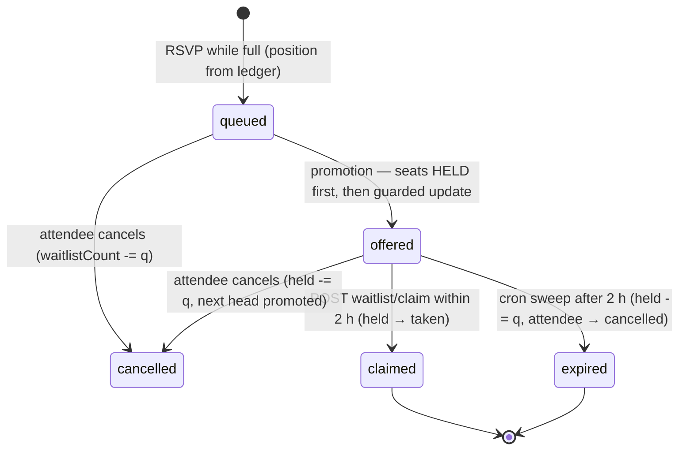
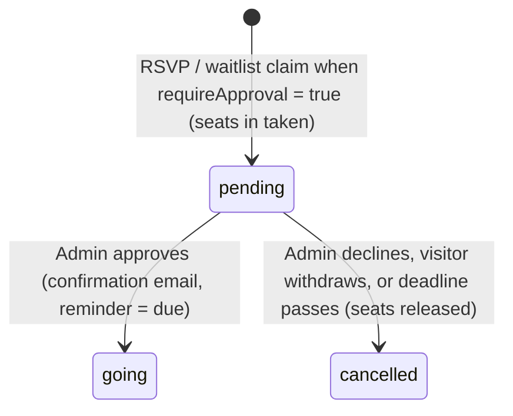

# Eventual Attendance — Specification

> Package `@vermeulen.solutions/eventual-attendance` · EmDash `>=1.2.0 <2.0.0` · sandboxed plugin
> Status: describes the code as built after the November 2026 audit fixes. Planned work is marked **Planned**.
> If code and this document disagree, fix whichever is wrong. Don't leave them out of sync.

---

## 1. Implementation status

**This table is the single record of what Attendance does today.** Update it in the same change as the code. Last updated 2026-11-10.

- **Built**: implemented, typechecked and built.
- **Planned**: designed and scheduled (detail in §12).
- **Open**: a known gap or limit without a scheduled fix (detail in §12).

The **Test** column names the covering test. Every *R* is in `tests/attendance.runtime.test.ts` (runtime host), and *U* is in `tests/security.test.ts` (unit). "None" means nothing automated covers the row.

### Registration and capacity

| Feature | Status | Spec | Test |
| :--- | :--- | :--- | :--- |
| RSVP per occurrence (single and recurring events) | Built | §8 | R "accepts every RSVP up to capacity…" |
| Zero-overselling seat ledger (KV revision CAS) | Built | §5 | R "never oversells under concurrent registrations" |
| Capacity, settings and queue shared by all translations | Built | §4.1, §3 | R "shares settings and seats across translations" |
| Closed by default; only published, non-ticketed events | Built | §3, §8 | R "keeps RSVPs closed unless enabled…" |
| Configurable event collection | Built | §3 | R "reads events from the configured collection" |
| Input validation (email, quantity, occurrence) | Built | §8 | R "rejects malformed quantities…" (quantity only) |
| Honeypot and form-timing checks | Built | §8 | U honeypot / timing (functions only, not through the route) |
| Idempotent RSVPs (`commandId`, replay, conflict, race) | Built | §8 | R "replays…", "refuses a reused id…", "books once when identical requests race" |
| Call budget ≤ 10 per invocation (`RpcBudget`), measured | Built | §2, §8 | Every invocation of the runtime suites (`tests/budget-guard.ts`), plus cold-isolate paths in `tests/budget.runtime.test.ts`. Highest measured: 10 (cold `rsvp` with Turnstile to the waitlist; cold `rsvp/form` schedules once; cold `attendance-approvals` cron) |
| Ledger, budget, tokens, secret and inventory mode from the shared `eventual-capacity` library | Built | §2, §5 | Library unit tests (19), plus the whole R suite running it inside the sandbox |
| Per-event booking approval (`requireApproval`, `approvalHours` 1–720, suite D16) | Built | §6.1, §8–§11 | R "approval" (9 tests): "a request holds its seat as pending and gets a request email", "approving confirms and sends the confirmation", "declining releases the seat, emails, and offers it to the waitlist", "a request past its deadline lapses", "the organiser is told about a new request", "reconcile counts pending requests as taken", "a pending request can't be checked in, can be withdrawn by its cancel link, and blocks deleting the event", "a waitlist claim on an approval event becomes a request", "French panel shows the approval settings" |
| Capacity override per occurrence | Open | §12 | — |
| Turnstile, opt-in per site (suite D13): keys on the Attendance page, widget in `RsvpForm` (flexible width, compact under 300 px, light theme), `rsvp` verifies after the replay check and before reserving; fails open only when Cloudflare can't be asked | Built | §8, §12 | R "turnstile (opt-in)" (4 tests); library `tests/turnstile.test.ts` |
| Per-IP rate limiting (suite D18) | Built | §8 | R "refuses the 11th booking from one IP within 10 minutes", "skips the IP limit when Turnstile is on", "stores only a hash of the IP" |
| Registration questions: one small form per question in the editor panel (the one-per-line text format remains for scripts); the form loads them, the server validates answers before reserving, and label snapshots are stored | Built | §8, §10, §11 | R "saves questions from the editor panel…", "edits questions one row at a time and keeps their ids", "refuses bad question lines…", "validates answers before reserving…", "tells the form when registration is closed…"; library unit tests |

### Waitlist

| Feature | Status | Spec | Test |
| :--- | :--- | :--- | :--- |
| FIFO queue with positions from the ledger | Built | §6 | R "accepts every RSVP up to capacity, then waitlists in FIFO order" |
| Freed seats held for the queue head; no queue-jumping | Built | §5, §6 | R "holds freed seats for the queue head…" |
| 2-hour claim offers, atomic claim | Built | §6 | R "holds freed seats…" (claim, single use) |
| Expiry sweep and next-in-line offer (cron) | Built | §9.1 | R "expires lapsed offers on the cron tick…" |
| Round-robin promotion across pools | Built | §9.1 | R "promotes on the cron tick when inline promotion was skipped" |
| Strict FIFO when the head needs more seats than are free | Built | §6 | R "holds freed seats…" (D stays queued) |
| "Move to end of waitlist" admin action | Built | §6 | R "unblocks a queue whose head can't fit the free seats…", "refuses to move someone who isn't waiting…" |

### Self-service and security

| Feature | Status | Spec | Test |
| :--- | :--- | :--- | :--- |
| POST-only cancel and claim through a site page (fragment tokens) | Built | §7 | R "is POST-only…", "rejects malformed tokens…" |
| Cancel releases seats exactly once under concurrency | Built | §5, §7 | R "releases seats exactly once under concurrent cancels" |
| HMAC tokens with purpose prefixes; only hashes stored | Built | §7 | U token tests |
| Signing key in plugin KV, generated on first use: no `EMDASH_ENCRYPTION_KEY` needed | Built | §7 | R "creates its signing key in plugin KV and needs no EMDASH_ENCRYPTION_KEY" (the suite runs without a key) |
| French and English: `locale` prop on `RsvpForm` and `RsvpManage`; the form sends its language, bookings store it, every email (confirmation, waitlist, offer, claim, move, reminder) uses it; site default language on the Attendance page | Built | §11 | R "sends emails in the language of the form…"; U `tests/calendar.test.ts` (French dates) |
| Event dates from `start`/`end` (Core) or `start_date`/`end_date` (other collections, e.g. camps); a bare date is all-day | Built | §9 | U `tests/calendar.test.ts` |
| Several event collections: the setting takes a comma-separated list (first = default); `RsvpForm` passes `collection`; only listed collections are read; bookings remember a non-default collection for calendar links | Built | §9 | R "takes bookings for every configured collection and refuses others" |
| Re-minted cancel link in the claim confirmation | Built | §7 | R "holds freed seats…" (C cancels with the emailed link) |
| Personal data retention setting (`retentionDays`: 30–3650 days, default 365) and automated hourly sweep (`attendance-retention`) erasing names, emails, and answers from past bookings; live checks use the event's own start for single events, so a booking without an occurrence date becomes past with its event | Built | §9.5 | R "privacy", "counts a booking without an occurrence as past once the event start has passed" |
| Erasure of personal data on request via admin page with live-registration protection | Built | §10 | R "privacy" |
| Secret rotation | Planned | §7 | — |

### Admin and operations

| Feature | Status | Spec | Test |
| :--- | :--- | :--- | :--- |
| Attendee list with native pagination and an event/date filter saved per admin | Built | §10 | R "renders a valid attendance page…", "filters totals, sessions and attendees to one event…", "narrows to one date…" |
| Check-in, refused for anyone not confirmed | Built | §10 | R "…checks in confirmed attendees only" |
| Admin cancel with confirm dialog and promotion | Built | §10 | R "admin cancel releases the seat and offers it to the head of the waitlist", "admin cancel on a cold isolate leaves the offer to cron" |
| Editor panel: settings per pool, ledger totals, mode-switch check | Built | §10 | R "saves editor-panel settings…", "shares settings…" |
| Single-use CSV and printable roster downloads; formula-safe CSV | Built | §10 | R "issues single-use roster downloads…" |
| Private `roster/export` for API clients | Built | §8 | R "roster/export refuses anonymous requests", "roster/export returns the CSV for an event" |
| Ledger reconcile job (quiet-period guarded) | Built | §9.2 | R "corrects ledger drift once the pool has been quiet…" |
| Schedule self-healing on admin page load | Built | §9 | R "re-schedules missing background tasks…" |
| Schedules created from the public `rsvp/form` route (sandboxed plugins in `astro.config` never get `plugin:activate`, suite P21) | Built | §9 | R "schedules its tasks from the public form route…" |
| Log lines counted against the call budget (`logWithin`, suite P2) | Built | §9 | Library unit test |
| Admin pages, editor panel and roster files in French or English, following EmDash's admin language (`ui.locale`); other languages get English | Built | §10 | R "speaks the admin UI's language…" |
| Public routes never show visitors raw host or database errors: unexpected failures are logged and answered with `TRY_AGAIN` (JSON) or a plain 503 (raw routes) | Built | §8 | R "public routes on failure" |
| Large pools (reconcile > ≈ 500 records, roster > 700 rows) | Accepted for 0.1 (owner, 10 Nov 2026) | §12 | Documented in README "Large events" |
| Admin overview from ledgers: site-wide totals (including pending approval requests), upcoming sessions, busiest start times | Built | §10 | R "filters totals, sessions and attendees to one event and lists its busiest slots", "a request holds its seat as pending and gets a request email" |
| Approve or decline pending approval requests (`approve-attendee`, `decline-attendee`) | Built | §6.1, §10 | R "approving confirms and sends the confirmation", "declining releases the seat, emails, and offers it to the waitlist" |
| Admin times, filter dates, busiest start times, roster CSV (`Local time` / `Heure locale`) and HTML roster in the event's time zone (UTC fallback) | Built | §4.1, §10 | R "formats Zurich sessions as local time in the overview and French CSV, and falls back to UTC"; library `tests/library.test.ts` |
| Admin page stays within the call budget (render reserve, light page) | Built | §10 | R "returns a light page after the maintenance button…" |
| Block trashing an event with live bookings | Built | §10 | R "blocks trashing an event with an upcoming registration" |

### Frontend and site setup

| Feature | Status | Spec | Test |
| :--- | :--- | :--- | :--- |
| `RsvpForm.astro` (envelope, messages, email-aware confirmations, `commandId`, questions, field errors, seat cap from the server, a11y states; the result/error message scrolls into view on phones, and a submission in flight ignores further clicks) | Built | §11 | U `tests/rsvp-i18n.test.ts` "keeps English and French client strings and no-email variants in sync" (strings in EN/FR); its script passes a strict `tsc` check |
| Confirmation offers the way to cancel: the `rsvp` answer carries the email's own `manageUrl` (`#action=cancel&token=…`) for the browser that booked; `RsvpForm` shows "Manage or cancel this registration" / "Gérer ou annuler cette inscription" after every success (going, waitlist, pending), with or without email. Replays leave it out | Built | §7, §11 | R "returns the email's own cancel link to the browser that booked, and it cancels", "leaves the manage link out of a replay"; test site "books a seat and shows the confirmation", "works in French" |
| `RsvpManage.astro` (fragment token, shows event, date and seats via `manage/lookup`, state-aware confirm, POST) | Built | §11 | R "shows what a cancel or claim link refers to…"; checked in the browser on the test site (Nov 2026) |
| Capacity field pack and exporter (merges into Core's blueprint) | Built (in `eventual-capacity`) | suite D2, README | Library unit tests; merged schema accepted by `emdash seed --validate` (manual, Nov 2026) |
| Accessibility: no axe WCAG 2.2 A/AA violations at 1280 and 320 px | Built | §11 | Test site `npm run test:a11y` (`scripts/test-accessibility.mjs`: 0 violations and 0 horizontal overflow across `RsvpForm` and `RsvpManage` at 1280×800 and 320×640) |

### Notifications

| Feature | Status | Spec | Test |
| :--- | :--- | :--- | :--- |
| Confirmation, waitlist, offer and claim emails | Built | §6, §8 | R (tokens read from captured emails) |
| Reminder emails (lead time configurable, at most once per attendee) | Built | §9.3 | R "sends each confirmed attendee one reminder…", "sends no reminders when the lead time is 0" |
| Calendar file per occurrence (`calendar` route), linked from confirmation, claim and reminder emails | Built | §8, §9.3 | R "serves a calendar file for an occurrence…"; library unit tests |
| Organiser `replyTo` (site-wide default, per-event override, snapshotted for later emails) | Built | §7, §10 | R "uses the site-wide reply-to, lets an event override it…" |
| Queued confirmation emails (`attendance-mail` cron task) when inline email cannot fit the call budget | Built | §9.4 | R "queued mail", "with Turnstile on: a cold first submission that joins the waitlist" |
| One command for release readiness (`npm run release:check`): tests, type check, manifest check, build, manifest version, changelog heading, packed files, self-contained `astro/` files, not `private` | Built (stops at the changelog step until the owner sets the release date; see the task 72 log) | §13 | `npm run release:check` (9 steps, one line each; never publishes) |

Out of scope for this plugin: payments, tickets and QR scanning (see the suite spec).

---

## 2. Constraints that shape this plugin

Everything below follows from these verified facts:

1. **10 host calls per invocation** (default `subrequests: 10`; the site operator may raise it). Every `ctx.kv`, `ctx.storage`, `ctx.content` and `ctx.email` call counts. Code is written for the default limit.
2. **50 ms CPU per invocation.** No heavy parsing or document generation inside a request.
3. **Plugin storage and KV are private to this plugin.** No other plugin can read or write the ledger.
4. **KV has no TTL.** Anything time-bound needs a sweep.
5. **CAS revisions are opaque host strings** from `getVersioned()`. They are never numbers stored in the value.
6. **Public routes return `{ success, data }` envelopes**, and raw routes may not serve HTML, JS, CSS, SVG or XML.
7. **Private routes reject browser navigation** (they require the `X-EmDash-Request: 1` header), so a plain link can't download from them.
8. **Block Kit runs no plugin JavaScript** in the admin.

### Design rules derived from them

- **Budget every call.** All host calls go through `RpcBudget` (`src/domain/budget.ts`), which throws before call 11. Fan-out work (promotions, expiries, emails) is bounded per invocation and drained by cron.
- **Order multi-store writes so a crash under-sells.** Hold seats before marking an offer; claim the entry before moving seats. A partial failure can leave a seat unused, never double-booked.
- **Every status change is a guarded `updateIf`.** `where: { status: <expected> }` makes concurrent cancels, claims and sweeps mutually exclusive.
- **Never change state on GET.** Email links open a site page; a button POSTs.
- **Tokens travel in URL fragments** (`#action=…&token=…`), which browsers never send to servers.
- **Every public write is an idempotent command.** The client creates a `commandId`; the record ID is derived from it and written with a create-only `compareAndSet`, so a retry or a racing duplicate returns the original outcome instead of acting twice.
- **Secrets live in encrypted `secret` settings**, never in KV.
- **Test on the real runtime host** (`createPluginRuntimeTestHost`), never on hand-written host mocks.

---

## 3. Manifest

```jsonc
{
  "slug": "eventual-attendance",
  "capabilities": ["content:read", "email:send", "network:request", "schema:read"],   // cron, KV and storage need no capability
  "allowedHosts": [],
  "storage": {
    "attendees": {
      "indexes": ["eventId", ["eventId", "occurrenceStart"], ["eventId", "status"],
                  ["eventId", "occurrenceStart", "status"], "email", "status",
                  ["status", "approvalDueAt"], "organiserNotice",
                  ["translationGroup", "occurrenceStart"], ["reminder", "status", "startsAt"],
                  ["mail", "status"], "cancelTokenHash", ["ipHash", "createdAt"], "retainFrom"]
    },
    "attendance_settings": { "indexes": ["eventId"] },
    "waitlist_entries": {
      "indexes": ["eventId", "poolKey", ["poolKey", "occurrenceStart"],
                  ["poolKey", "occurrenceStart", "status"],
                  ["poolKey", "occurrenceStart", "status", "position"],
                  "status", ["status", "offerExpiresAt"], "offerExpiresAt", "position", "claimTokenHash"]
    }
  },
  "admin": {
    "pages": [
      { "path": "/attendance", "label": "Registrations", "icon": "users" },
      { "path": "/attendance/roster", "label": "Door list", "icon": "list-checks" },
      { "path": "/attendance/settings", "label": "Registration settings", "icon": "settings" }
    ],
    "editorPanels": [{ "id": "event-attendance", "title": "Registrations",
                       "route": "admin/editor/attendance", "order": 20 }]
  }
}
```

Event content is read from the collection named in `config:v1.eventCollection` (default `events`, set on the Attendance admin page; suite D3). Invalid slugs fall back to the default. The editor panel shows only on that collection.

EmDash field slugs are snake_case. The plugin reads `inventory_mode`, `capacity` and `allow_waitlist`. Core's blueprint doesn't include these fields. They come from the capacity field pack (suite D2); until then they are simply absent and the editor panel is used instead.

**Effective settings** (`resolveAttendance`, `src/domain/event-settings.ts`), in order of precedence:
1. Panel settings stored under the pool key.
2. Field-pack values on the event.
3. Defaults: `maxPerRegistration` 4, unlimited capacity, no waitlist.

**RSVPs are closed by default.** `enabled` comes from the panel. Without panel settings it is `true` only when `inventory_mode === "rsvp"`.

An event accepts RSVPs only when all of these hold:
- it is `published`
- its mode isn't `tickets`
- RSVPs are enabled

---

## 4. Data model

### 4.1 KV records

| Key | Value | Written by |
| :--- | :--- | :--- |
| `ledger:<poolKey>[:<occurrenceStart>]` | `CapacityLedger` | RSVP, cancel, claim, promotion, cron |
| `config:v1` | `{ managePagePath, eventCollection }` | Admin form only (validated). Absent until first saved; defaults apply. Cached per isolate for 60 s |
| `export:<sha256(token)>` | `{ eventId?, occurrenceStart?, format, expiresAt }` | Admin "prepare export"; deleted on use |
| `state:maintenance-cursor` | last ledger key the maintenance task tried | Cron (round-robin fairness) |
| `state:reconcile-cursor` | last ledger key the reconcile task checked | Cron / admin button |

`attendance_settings` records are keyed by **pool key**, so one record covers every translation.

**Settings:** none. The link-signing key is in KV under `state:signing-key` (§7).

`poolKey = event.translationGroup || event.id`. All translations of an event fill the same room and share one queue.

```ts
interface CapacityLedger {
  capacity: number;      // 0 = unlimited (no waitlist possible)
  taken: number;         // seats of going/attended attendees
  held: number;          // seats reserved for outstanding waitlist offers
  waitlistCount: number; // seats of queued waitlist entries
  poolKey: string;
  label?: string;        // event title snapshot for admin tables
  timezone?: string;     // validated IANA event time zone snapshot
  nextPosition: number;  // next FIFO position, assigned inside the same CAS as the reservation
  occurrenceStart: string;
  updatedAt: string;
}
```

**Invariants**
- `taken + held <= capacity` whenever `capacity > 0`.
- `freeSeats = capacity - taken - held`.
- While the waitlist is enabled and `waitlistCount > 0`, new registrants are queued even if seats are free. Free seats belong to the queue head.

### 4.2 Storage collections

```ts
type AttendeeStatus = 'going' | 'pending' | 'waitlist' | 'cancelled' | 'attended';

interface AttendeeRecord {
  id: string;                 // att_ + 32 hex of SHA-256("rsvp:" ‖ eventId ‖ ":" ‖ commandId)
  eventId: string;
  translationGroup?: string;  // the poolKey at registration time
  occurrenceStart: string;    // canonical UTC ISO instant, "" for single events
  email: string;              // lowercased, format-checked
  displayName: string;        // ≤ 100 chars
  status: AttendeeStatus;
  quantity: number;           // safe integer 1..maxPerRegistration (≤ 20)
  cancelTokenHash: string;    // SHA-256 of the cancel token
  commandId: string;          // client idempotency key, or srv_<uuid> when none was sent
  waitlistEntryId?: string;
  waitlistPosition?: number;  // kept so a replayed request can answer with it
  approvalDueAt?: string;     // ISO instant pending approval expires (min of now + approvalHours, startsAt)
  organiserNotice?: 'queued' | 'sent'; // set only when requireApproval and an organiser replyTo exists
  answers?: Answer[];         // validated answers with label snapshots: { id, label, value }
  ipHash?: string;            // first 32 hex of HMAC-SHA256(signingKey, "ip:" + ip) when known & Turnstile off
  checkedInAt?: string;
  orderId?: string; ticketTierId?: string; qrHash?: string; // reserved, unused
  retainFrom?: string;        // ISO instant retention counts from (startsAt ?? createdAt)
  erasedAt?: string;          // ISO instant personal details were erased
  createdAt: string; updatedAt: string;
}

type WaitlistStatus = 'queued' | 'offered' | 'claimed' | 'expired' | 'cancelled';

interface WaitlistEntry {
  id: string;                 // wl_<uuid>
  eventId: string;
  poolKey: string;
  occurrenceStart: string;
  attendeeId: string;
  quantity: number;           // denormalised: promotion must not spend calls re-reading
  email: string; displayName: string; eventTitle?: string; // denormalised for the offer email
  position: number;           // from ledger.nextPosition — unique per pool
  status: WaitlistStatus;
  claimTokenHash?: string;
  offerExpiresAt?: string;    // offer time + 2 h
  retainFrom?: string;        // ISO instant retention counts from (startsAt ?? occurrenceStart ?? createdAt)
  erasedAt?: string;          // ISO instant personal details were erased
  createdAt: string; claimedAt?: string; updatedAt: string;
}

interface EventAttendanceConfig {   // attendance_settings, keyed by pool key
  enabled: boolean; capacity: number; maxPerRegistration: number;
  allowWaitlist: boolean; requireApproval: boolean;
  approvalHours: number;      // 1–720, default 48
  replyTo?: string;
  questions?: QuestionDefinition[]; // { id, label, type, required, options? }, from eventual-capacity
}
```

---

## 5. Seat ledger

The ledger code lives in the shared `eventual-capacity` library (a dev dependency, inlined into the plugin bundle; suite P20). `reserveSeats(kv, budget, key, { quantity, capacity, allowWaitlist, occurrenceStart, poolKey, maxAttempts })` returns `going` (with `remaining`), `waitlist` (with `position`), or a failure `FULL` / `BUSY`, which Attendance turns into its own messages.

`updateLedger(kv, budget, key, compute, maxAttempts)` runs `getVersioned` → pure `compute` → `compareAndSet(key, revision, next)`. Each attempt costs 2 calls. After a conflict it re-reads and recomputes. Attempts are capped by the caller and by the remaining budget.

| Operation | Effect | Aborts when |
| :--- | :--- | :--- |
| `reserveSeats` | `taken += q` (going), or `waitlistCount += q`, `nextPosition++` (waitlist) | no seats free and the waitlist is off/unlimited → `full` |
| `holdSeatsForOffer` | `held += q`, `waitlistCount -= q` | `freeSeats < q` (strict FIFO: the head blocks the line) |
| `adjustLedger({ taken })` | release confirmed seats | — |
| `adjustLedger({ held })` | release an expired or cancelled offer | — |
| `adjustLedger({ waitlistCount })` | remove a queued entry (a negative value re-adds it) | — |
| `adjustLedger({ heldToTaken })` | claim: move seats without changing occupancy | — |

Every request recomputes the ledger's `capacity` from the current event settings, so changing the capacity takes effect on the next reservation.

**Accepted risk:** a request that gives up after exhausting its CAS attempts reports `High registration traffic` instead of booking. A lost RSVP response is resolved by the idempotent retry (§8), and `rsvp` reserves only when enough calls remain to leave 4 calls after reserving (`attendee` write 1 + loser release 2 + winner read 1, limiting CAS retries under tight budgets rather than leaving a racing duplicate unable to return its seat). For other flows, holds and releases are idempotent at the entry level (guarded `updateIf`), so the worst case is unused seats, which the reconcile job (§9.2) returns.

---

## 6. Waitlist lifecycle



**Promotion** (`promoteNextWaitlistEntry`, ≤ 6 calls):
1. Query the queue head: `{ poolKey, occurrenceStart, status: 'queued' }`, ordered by `position`, limit 1.
2. Load the config (cached per isolate).
3. `holdSeatsForOffer`. Stop if there aren't enough seats.
4. Mint the claim token and run a guarded update `queued → offered`. If the guard fails (cancelled concurrently), return the hold.
5. Email the offer (failures are logged, never rolled back).

**Triggers:** an inline promotion after a cancel when the budget still allows one; otherwise the next cron tick. Fairness doesn't depend on inline promotion, because new registrants queue behind waiting attendees either way.

**Strict FIFO (suite D7):** if the head wants 2 seats and 1 is free, nobody behind them is offered the single seat. Best fit would let small parties overtake larger ones, which is the opposite of the fairness guarantee, so it won't be built.

The mitigation is the admin action **"Move to end of waitlist"** (`moveToEndOfQueue`, ≤ 8 calls), shown on each waitlisted attendee with a confirm dialog. It works only on a `queued` entry, never during an open offer. It takes a new tail position from the ledger's `nextPosition` CAS (the same counter that numbers new registrations) and moves the entry with a guarded `updateIf` on its old `status` and `position`, so concurrent moves and promotions can't collide; a lost race only burns a position number. Seats are untouched, so the next maintenance tick offers the free seats to the new head. The attendee is emailed that they keep a place at the end of the line. The `maxPerRegistration` default of 4 keeps blocking rare.

## 6.1 Approval lifecycle (suite D16)

Events with `requireApproval: true` hold bookings as requests instead of immediately confirming them:



- **Seat accounting:** `pending` requests hold seats in `ledger.taken`, so sessions cannot oversell and waitlists engage at capacity. `reconcileLedger`, `hasLiveRegistrations` (delete guard), `attendance-retention`, and admin erasure all count `pending` as live/taken. Reminders and check-in ignore `pending` rows until approved.
- **Deadlines:** `approvalDueAt` is the earlier of `now + approvalHours` (`1..720`, default `48`) and the session start (`timing.startsAt`). Waitlist claims on approval events resolve `attendance_settings` when budget allows (1 call; else claim as `going` and log) and enter `pending` with their own deadline.
- **Emails (EN / FR):**
  - On request: `requestReceived` to visitor (inline, or `mail: "queued"` for `attendance-mail`).
  - On approval (`approve-attendee`): `rsvpConfirmed` with calendar and cancel links (inline when budget permits, else `mail: "queued"`).
  - On admin decline (`decline-attendee`): `requestDeclined` to visitor (and waitlist promotion if budget permits, else left to `waitlist-maintenance`).
  - On deadline expiry (`attendance-approvals`): `requestLapsed` to visitor.
  - To organiser: `organiserNotice: "queued"` is recorded when an event or site `replyTo` exists, and `attendance-approvals` (`*/5 * * * *`) emails `organiserNewRequest` in the site default locale (`config.defaultLocale`), formatting dates in the event time zone. Cancelling, declining, or approving clears `"queued"` → `"sent"` so no stale notice is sent.
- **Measured call counts (`tests/budget.runtime.test.ts`):** `rsvp pending (cold)` 8; `approve-attendee` 7; `decline-attendee (warm)` 8 / `(cold)` 7; `cron attendance-approvals (cold)` 10 (1 lapsed decline + email + 1 queued organiser notice).

---

## 7. Tokens and self-service

- **Signing key:** 32 random bytes in plugin KV (`state:signing-key`), created on first use with a create-only CAS (the library's `loadSigningSecret`). Plugin KV is private to Attendance (suite P3).
  - **Why not an encrypted setting (decided Nov 2026).** EmDash encrypts `secret` settings with `EMDASH_ENCRYPTION_KEY`, which the site operator must provide, and refuses them without it. Requiring that for a key nobody types in made a free RSVP plugin unusable until someone set a Worker secret. EmDash keeps its own generated secrets (preview secret, IP salt) in the database the same way.
  - **Residual risk, accepted.** Tokens are derived from `attendeeId`, `createdAt` and `eventId`, which sit in the database next to the key. Someone with a **read-only copy of the database** (for example a leaked backup) could mint valid cancel and claim links, and so cancel bookings or claim offered seats. Anyone with write access can change bookings directly anyway. Protect database backups like the database.
  - **Rotation.** Deleting `state:signing-key` makes the next request create a new key; every link already emailed stops working. A value that isn't a 64-hex key is replaced the same way.
- **Cancel token:** `HMAC-SHA256(secret, "cancel:" ‖ attendeeId ‖ ":" ‖ createdAt ‖ ":" ‖ eventId)`. Deterministic, so later emails (claim confirmation, reminders) can re-create the same link.
- **Claim token:** `HMAC-SHA256(secret, "claim:" ‖ entryId ‖ ":" ‖ eventId ‖ ":" ‖ offerExpiresAt)`.
- **Storage:** only `SHA-256(token)` is stored, and it is indexed for lookup. Tokens must match `^[0-9a-f]{64}$` before any storage call.
- **Delivery:** `https://<site><managePagePath>#action=cancel|claim&token=<token>`. The default path is `/rsvp/manage` (set on the Attendance admin page; it must be root-relative).
- **Manage page:** the `RsvpManage.astro` component reads the fragment and removes it from history. It first POSTs `{ action, token }` to the read-only `manage/lookup` route and shows the event, date, seats and (for offers) the claim deadline, with a question that fits the booking's state: cancel a reservation, leave the waitlist, claim a spot, or a plain message when it's already cancelled, claimed, expired or checked in. The confirm button then POSTs `{ token }` to `cancel` or `waitlist/claim`, and the result replaces the question. Link scanners that only fetch the page change nothing; another link opened in the same tab reloads the page.
- **Secret rotation:** **Planned.** Rotating today invalidates every outstanding link.

---

## 8. Routes

All handlers create their own `RpcBudget`. Public routes are wrapped so an unexpected failure (a missing collection, a database error, a spent budget) never reaches the visitor as host text: it is logged (unless the budget is spent) and answered with `{ ok: false, error: "TRY_AGAIN" }`, or a plain-text 503 for raw routes. Worst-case call counts:

| Route | Access | Method / body | Calls (worst) | Notes |
| :--- | :--- | :--- | :--- | :--- |
| `rsvp` | public | POST json | 10 | config 0 warm / 2 cold, replay lookup 1 (skipped on a command's first submission), Turnstile `siteverify` 1 (when on) **or** per-IP limit query 1 (when Turnstile is off and `requestMeta.ip` is present; refuses > 10 bookings per IP hash in 10 min), content 1, settings 1, ledger 2–4 (`budget.has(4)` pre-check; `attempts` keeps 4 calls after reserving for attendee create 1 + release 2 + winner read 1, or waitlist write + inline email), attendee create 1, waitlist entry 1, email inline when 1 call is left after the writes, else `mail: "queued"` (0 extra calls) and `attendance-mail` sends it within a minute. On `requireApproval` events, non-waitlist spots record `status: "pending"`, `approvalDueAt`, and `organiserNotice: "queued"` when a `replyTo` exists, sending `requestReceived`. The success answer also carries `manageUrl` (the email's cancel link, built by HMAC with no host call) for the browser that booked; replays leave it out |
| `rsvp/form` | public, cached 1 min (`no-store`) | GET `?eventId=` | 4 | editable config 0–1 (no secret), content 1, settings 1, ledger 0–1. Returns `{ open, maxPerRegistration, allowWaitlist, requiresApproval?, seatsLeft, full, questions }` for a published, RSVP-managed event, and no questions while closed; scheduling uses at most 4 calls left after the route |
| `cancel` | public | POST json `{token}` | 10 | lookup 1, guarded cancel 1 (for `going` or `pending`), entry 0–4, ledger 2–4, inline promotion 6 only if the budget allows |
| `manage/lookup` | public | POST json `{action, token}` | 1 | read-only: event title, date, seats and state (`going`, `pending`, `waitlist`, etc.) for a cancel or claim link; never the email address |
| `waitlist/claim` | public | POST json `{token}` | 9 | lookup 1, guarded claim 1, ledger 2–4, attendee 1, settings 0–1 (approval check), config ≤ 1, email 1 (`claimConfirmed` or `requestReceived`) |
| `calendar` | public, cached 5 min | GET `?eventId=&occurrence=` | 3 | editable config 0–1 (no key read), content 1, public URL 1. Published events only; the series duration is applied to the occurrence; `text/calendar` attachment |
| `roster/download` | public, capability token | GET `?token=` | 10 | grant read 1, single-use delete 1, ≤ 7 pages of 100 rows, title 1. Truncation is stated in the file |
| `roster/export` | private `content:edit_any` | GET | 10 | for token-authenticated API clients; same output |
| `admin` | private `content:edit_any` | Block Kit | ≤ 10 | Actions first (check-in, approve/decline request, cancel and promotion, move-to-end, config, filter, export links), then the page with 5 calls reserved: ledgers 1, filter 1, attendees 1, config 0–2, plus optional pending count 1 when `budget.has(6)`. Schedules are checked on page load (1, +1 per missing task). The maintenance and reconcile buttons use the request's budget and return a light page (§10) |
| `admin/editor/attendance` | private `content:edit_any` | Block Kit panel | ≤ 8 | language pack 0–1, config 0–2, content 1, collection schema 0–1, settings 1, save 1, ledger totals 1 (`kv.list` of the pool) |

**Idempotency on `rsvp`.**
- `RsvpForm` sends a `commandId` (32 hex chars), the same one on every retry of an attempt, and a new one after each success.
- The attendee ID is derived from it, so:
  - A sequential retry finds the existing record with one `get` and **replays** the original answer (`replayed: true`) without reserving.
  - If identical requests race, the attendee record is written with a create-only `compareAndSet`, so exactly one wins. The others return the seats they reserved (or leave them for the reconcile job when out of budget) and replay the winner's answer, or return `TRY_AGAIN`.
- The same `commandId` with different contents → `IDEMPOTENCY_CONFLICT`. Replaying a since-cancelled registration → `ALREADY_CANCELLED`.
- A unique index on `commandId` is deliberately **not** used: the runtime test host does not enforce `uniqueIndexes` on `put`, and production enforcement is unverified (suite P17).

Event checks on `rsvp`, in order:
1. Not found in the configured collection → `EVENT_NOT_FOUND`.
2. Not `published` → `EVENT_NOT_PUBLISHED`.
3. `inventory_mode = "tickets"` → `EVENT_TICKETED`.
4. Not enabled → `RSVP_DISABLED`.

Validation on `rsvp`:
- **Honeypot** filled → fake success.
- **Timing:** `formTimestamp` present and outside 1.5 s–2 h → `INVALID_SUBMISSION_TIMING`.
- **Email** fails the format check → `INVALID_EMAIL`.
- **Quantity** not a safe integer from 1 to 20 → `INVALID_QUANTITY`.
- **`occurrenceStart`** not parseable → `INVALID_OCCURRENCE`.
- **Answers** are checked against the event's questions (`validateAnswers` in `eventual-capacity`) **before any seat is reserved**: required answers, types (email, phone, number, date, select options, single-line text), and lengths (500, or 2,000 for textarea). Unknown keys are dropped. Failures return `INVALID_ANSWERS` with `fields: { [questionId]: "REQUIRED" | "INVALID" | "TOO_LONG" }`. Accepted answers are stored in question order with label snapshots, so renaming a question later doesn't relabel old bookings.

Responses are application objects (`{ ok, … }`) inside the host's `{ success, data }` envelope.

---

## 9. Scheduled maintenance

Tasks are listed in `src/domain/schedules.ts`:

| Task | Schedule | Function |
| :--- | :--- | :--- |
| `waitlist-maintenance` | `* * * * *` | `runWaitlistMaintenance` |
| `ledger-reconcile` | `*/10 * * * *` | `runReconcileTick` |
| `attendance-reminders` | `* * * * *` | `runReminderTick` |
| `attendance-mail` | `* * * * *` | `runQueuedMailTick` |
| `attendance-approvals` | `*/5 * * * *` | `runApprovalTick` |
| `attendance-retention` | `17 * * * *` | `runRetentionTick` |

`plugin:activate` schedules the tasks. Because `plugin:activate` doesn't run again when an installed plugin is updated, the admin page calls `ensureSchedules` on every page load. It lists the tasks and re-schedules any that are missing or have a changed expression. EmDash never runs `plugin:activate` for a sandboxed plugin listed in `astro.config` (suite P21), so the public `rsvp/form` route, which every event page loads, also calls the library's `ensureSchedulesOnce`. That records a fingerprint of the task list in KV and costs nothing once an isolate has confirmed it.

### 9.1 Waitlist maintenance

Each tick (≤ 10 calls):

1. Query up to 2 lapsed offers: `{ status: 'offered', offerExpiresAt ≤ now }`, ordered by expiry.
2. For each, while ≥ 5 calls remain: guarded `offered → expired`, `held -= q`, attendee `waitlist → cancelled`.
3. `kv.list("ledger:")`. Candidates are ledgers with `waitlistCount > 0` and free seats.
4. Rotate the candidates past `state:maintenance-cursor` and promote while ≥ 6 calls remain, then advance the cursor.

Throughput at the default limit is about **1 promotion or 2 expiries per minute** across the whole site. That's enough for small and medium events. Raising the operator limit raises it proportionally; large events need that or a faster schedule. The admin page has a "Run waitlist maintenance now" button.

### 9.2 Ledger reconcile

Partial failures can only under-sell (§2), but under-selling is still lost seats. Each tick (`runReconcileTick`) checks **one** ledger, chosen round-robin from `kv.list("ledger:")`, with `reconcileLedger` (`src/domain/reconcile.ts`):

1. Read the ledger with its revision.
2. Page through the pool's attendees (`translationGroup`, `occurrenceStart` index) and waitlist entries (`poolKey`, `occurrenceStart`). Recompute:
   - `taken` = going + attended + pending
   - `held` = offered
   - `waitlistCount` = queued
   - `nextPosition` ≥ the highest position + 1
3. Write the result with the revision from step 1, but only if it differs.

**Safety against live traffic:** every flow writes its ledger and records within one invocation (≤ 30 s wall time). The job skips a pool (`BUSY`) if the ledger *or any scanned record* was updated in the last 10 minutes. It also writes with the pre-scan revision, so any concurrent ledger write makes the CAS fail (`CONFLICT`) and the pool is retried later. Corrections are logged with before and after values.

**Limits:** about 5 pages (≈ 500 records) per pool-occurrence per tick. Larger pools report `TOO_LARGE` and are skipped. With many ledgers a full pass takes `ledgers × 10 min`. The admin "Check next seat ledger" button advances it manually.

---

### 9.3 Reminders

- **At registration:** each attendee gets `startsAt`, the occurrence instant from `occurrenceStart`, or from the event's `start` / `start_date`. It also gets snapshots of the title and time zone, and `reminder: "due"`. Events without a usable start get no reminder.
- **Each tick (`runReminderTick`, ≤ 9 calls):**
  1. Load the config.
  2. Query `{ reminder: "due", status: "going", startsAt in (now, now + lead] }`, ordered by `startsAt`, 3 per tick. Index: `["reminder", "status", "startsAt"]`.
  3. For each, flip to `"sent"` with a guarded `updateIf` *before* sending, so overlapping ticks can't double-send. A crash after the flip loses that one reminder (at most once).
- **Email:** the date in the event's time zone, a calendar link, a cancellation link and the reply-to.
- **Lead time:** `reminderLeadHours` (0–168, default 24, 0 = off) on the Attendance admin page.
- **Throughput:** about 3 per minute, roughly 180 per hour per site. For a large event, reminders go out over the hour after the lead window opens. Already-reminded, cancelled and checked-in attendees are never queried.

### 9.4 Queued confirmation emails

When an RSVP booking cannot afford to send its confirmation email within the 10-call RPC budget (for example a cold isolate with Turnstile enabled joining the waitlist), the booking route marks the attendee record with `mail: "queued"` at zero extra call cost.

Each tick (`runQueuedMailTick`, ≤ 10 calls):
1. Load config (1–2 calls).
2. Query `attendees` with `where: { mail: "queued" }`, limit 3 (covers `going`, `pending`, and `waitlist` via the `["mail", "status"]` prefix in 1 call; non-active rows are skipped after claiming).
3. For each record (up to 3, while ≥ 2 calls remain):
   - Claim record with guarded `updateIf` (`mail: "sent"`, 1 call).
   - Reconstruct message (`rsvpConfirmed`, `requestReceived`, or `waitlisted`) with deterministic cancel token and send email (1 call). Failures are logged.
Worst case: 2 config + 1 query + 3 × 2 = 9 calls.

### 9.5 Automated personal data retention (`attendance-retention`)

Runs hourly at minute 17 (`17 * * * *`). Erases personal attendee details (`displayName: ""`, `email: ""`, `answers: []`, `replyTo: ""`, `ipHash: ""`, `retainFrom: "~erased"`, `erasedAt: nowIso`) for records whose `retainFrom` is older than `now − retentionDays * 86,400,000`.

- Retention setting: `retentionDays` (30–3650, default 365) saved in `config:v1`.
- Sweeps up to 4 attendees, and with remaining budget (leaving ≥ 1 spare), up to 4 waitlist entries per tick.
- Records created before this field existed have no `retainFrom` and are never swept.
- Bookings for an event without a date are kept while they're live; the period starts again each time the sweep finds one.
- Worst case: 1 config + 1 query attendees + 4 updates + 1 query waitlist + 2 updates ≤ 10 calls.

### 9.6 Approval deadlines and organiser notices (`attendance-approvals`)

Runs every 5 minutes (`*/5 * * * *`, `runApprovalTick` in `src/domain/approvals.ts`, ≤ 10 calls):
1. Load `config` once at the start (0 warm / 2 cold).
2. Query `attendees` with `where: { status: "pending", approvalDueAt: { lt: nowIso } }`, `limit: 2`. While `budget.has(4)`: decline via `cancelAttendee` (releases `taken` seats and clears any queued organiser notice) and send `requestLapsed` when budget allows (`1` call). Waitlist promotion is left to `waitlist-maintenance`.
3. While `budget.has(3)`, query `where: { organiserNotice: "queued" }`, `limit: 2`. For each, atomically claim `organiserNotice: "queued" → "sent"` and email `organiserNewRequest` in `config.defaultLocale` to `row.replyTo || config.replyTo` (skipping if empty or no longer `pending`).
Measured cold tick (1 lapsed + 1 queued notice): 10 calls.

## 10. Admin UI (Block Kit)

**Language.** Every admin page, the editor panel, toasts and the roster files use EmDash's admin language (`ui.locale`, from the admin's language setting): French for `fr`, English for anything else. Texts live in `src/admin/i18n.ts`. The roster download link stores the language, so the file matches the page it came from. Registration-question parse errors come from the shared library with structured issue codes and are translated in the editor panel (English or French).

**`/attendance`**
- **Totals from the seat ledgers**, not from one page of attendee rows: booked seats, offers out, waiting and capacity used across all upcoming sessions. One `kv.list("ledger:")` call. Each ledger carries a `label` (the event title, refreshed on every reservation) for display. On overview loads with `budget.has(RENDER_COST + 1)`, adds one query (`status: "pending"`, limit 50) to show **Requests waiting** (`"50+"` at limit); skipped when cold action work leaves too few calls.
- **Busiest start times** ("When sessions fill up"): a table of up to 8 weekday × start-hour slots, busiest first, with the average share of seats in use, the number of sessions and the weekday. It covers upcoming, capacity-limited, dated sessions; a waitlist counts as 100 %. Times use each ledger's event time zone (`zonedParts`, falling back to UTC). Shown when at least two sessions qualify. (An ECharts heatmap was tried first, but the admin's chart registry has no heatmap series or visual map, so it rendered as an empty box.)
- **Upcoming sessions table:** one row per ledger, giving booked, offers out, waiting, capacity and % used (open / filling / busy). Occurrence times are formatted in the event's time zone (`formatInZone`, falling back to UTC). Occurrences stay "upcoming" until 12 hours after they start.
- **Attendee filter:** an event then date select (date options formatted in the session's time zone). It's saved per admin in KV (`state:admin-filter:<userId>`) so pagination and reloads keep it, and values that no longer exist are dropped. The filter narrows the totals, heatmap, sessions table and attendee list. The attendee query uses the `["translationGroup", "occurrenceStart"]` index.
- **Attendee table** with native pagination (`page_action_id: "page-attendees"`, `next_cursor`), occurrence times formatted in the attendee's or session's time zone, plus row actions:
  - **Approve / Decline:** for `pending` requests; **Approve** moves `pending → going` (enables `reminder: "due"` on dated events) and emails `rsvpConfirmed` inline or queued; **Decline** (confirm dialog) cancels via `cancelAttendee`, emails `requestDeclined`, and promotes the waitlist if budget allows.
  - **Check-in:** a guarded `going → attended`, refused for anyone else (including `pending`).
  - **Move to end of waitlist** (§6), for waitlisted attendees.
  - **Cancel:** danger-styled with a confirm dialog. It releases seats and promotes the queue head.
- **Settings form:** event collection, manage-page path, reply-to, reminder lead time, retention days (30–3650, default 365), and Turnstile keys. Plus buttons for waitlist maintenance and the reconcile check.
- **Personal data section:** a lookup form (`find-personal-data`) by email address. Displays matching attendee records and waitlist entries with status and session date. If any non-live records exist, shows an "Erase personal data" button with a confirm dialog (`erase-personal-data`). Erases up to 6 non-live records per pass; active registrations are protected from erasure until cancelled.
- **Erased records** (`erasedAt` set) stay in the attendee and roster tables so the seat counts add up: name and email show `—`, the status badge is `Erased` / `Effacé·e`, answers are empty, and the row offers no actions. The action handlers also refuse a stale action on an erased record: check-in answers "Only confirmed attendees can be checked in.", approve/decline "This request was already processed", move "Only people waiting in the queue can be moved", cancel "This RSVP was already cancelled." The CSV and printable roster show the same `—` and `Erased`.
- **Navigation** uses `link` elements with `plugin-page` targets.
- **Call budget.** The page reserves 5 calls to draw itself (ledgers 1, filter 1, attendees 1, config 0–2). Actions leave that much: inline promotion after a cancel runs when it fits, otherwise cron does it within a minute. When an action used too much, the response is a light "Done" page instead of an error. An admin cancel that promotes inline returns the light page. The maintenance and reconcile buttons do a cron tick's work with the request's own budget, so they always return the light page.

**`/attendance/roster`**
- The same event/date filter narrows the roster table.
- "Prepare printable roster" / "Prepare CSV roster" (`prepare-export-html` / `prepare-export-csv`; the old shared `prepare-export` id with `value: "html" | "csv"` still works) create a single-use link that expires after 10 minutes, shown as an external link to `roster/download`. Only the token's hash is stored.
- **Roster CSV and printable HTML:** CSV keeps the machine-readable ISO UTC `Occurrence Time` / `Date de la séance` column and adds `Local time` / `Heure locale` formatted in the attendee's time zone (`formatInZone`, falling back to UTC). CSV values are quoted, and values starting with `= + - @` (also their full-width forms), tab or CR are prefixed with `'`.
- The printable roster formats its session date and rows in the event's time zone as an `.html` attachment (`application/octet-stream`) that the organiser opens locally and prints. On-site HTML is not allowed.

**Editor panel (redesigned in round 10).** Top line: open or closed, places taken (of the capacity), places on offer and people waiting, with a **View registrations** button that opens the Registrations page narrowed to this event. Then one settings form: **Open for registration**, most places per person, **approve each registration yourself** + hours to decide (`approvalHours`, 1–720, shown only when approval is on), reply-to. It has its own save button, and says so, because EmDash's own Save does not include panel values.

- **One home for capacity, the waitlist switch and opening.** When the event's collection has the field-pack fields (`capacity`, `allow_waitlist`, `inventory_mode`), the panel shows their values read-only ("From the event form: …") with a pointer to the event form, and its form has no input for them. EmDash leaves empty fields out of an entry's `data`, so the collection's schema decides (`schema:read`, `src/domain/event-fields.ts`: 0 calls when the entry already shows all three, else 1 per collection per isolate per minute; without schema access, any of the three in the data counts as the pack). A collection without a field gets that input in the panel (**Open for registration**, places, waiting list). `save-attendance-settings` still accepts `enabled`, `capacity` and `allowWaitlist` from a script. Any save drops a stored value that equals the event's field, so a later change to the field applies; a differing one still wins, and the panel shows a banner with **Use the event's fields** (`use-event-fields`), which removes the stored copies.
- **Other collections.** EmDash's manifest can scope a panel only to collections fixed at build time, while the event collections are a site setting, so the panel is offered on every collection. Outside the configured collections it answers one context line: "Registrations are not used for this kind of content.", or, for a collection that has the capacity fields, the pointer to **Site setup**.
- **Questions as rows.** Block Kit's `repeater` can't be used in a sandboxed panel form, so each question is an `accordion` holding its own small `form` (question, kind of answer, choices shown only for "Choice from a list" through a field `condition`, must-be-answered) with **Save question**, **Remove** (confirm) and **Move up**; a last accordion adds a question. Actions: `add-question`, `save-question:<id>`, `remove-question`, `move-question-up`. A question keeps its `id` when its label changes, so answers already given still match. Each row is checked with the library's `parseQuestionLines` (one line), so rows and the text format follow the same rules; a refused row is shown again, open, with what was typed.
- **Text format, for scripts.** `save-attendance-settings` still accepts `questions` as text, one per line: `Label | type | required | options` (for example `T-shirt size | select | required | S, M, L`), and `capacity` / `allowWaitlist` when a caller sends them. A line that doesn't parse blocks the whole save and reports line numbers. When `questions` is absent (the panel's own form), the saved questions are kept.
- Types: text, textarea, email, phone, number, date, checkbox, select; up to 20 questions.

**Admin pages (redesigned in round 10).** Three pages, linked from each other and from the sidebar:

- **Registrations** (`/attendance`). In order: requests waiting for a decision (up to 8 as text + Approve / Decline buttons, with the decide-by time; these work on a phone, where tables hide their button columns); three figures (registered, waiting list, to approve); upcoming events with "taken / places", a status word (Full, Almost full from 80 %, Places left, No limit) and a **View** button (`view-session`) that narrows the list to that event; the busiest weekday/hour slots, folded away; then the list of registrations with a filter (event and date pickers appear only when there is something to choose) and a **name or email search**. An email address is looked up through the `email` index; a name is matched in memory over up to three pages of 100 in the selected event, and the page says when the list was not searched to the end. Search results are shown as text + buttons rather than a table.
- **Door list** (`/attendance/roster`). For the device at the door: one line per person who has a place (confirmed or checked in) with a single **Check in** / **Undo check-in** button (`undo-checkin`: attended → going, guarded by `updateIf`), an arrivals count, a name search, and the printable list and CSV underneath. With one event it opens on that event; otherwise it asks for one.
- **Registration settings** (`/attendance/settings`). The organiser's settings (reply-to, reminder lead time, email language, retention) and personal-data erasure; the site builder's settings (collections, self-service page path, Turnstile keys, component endpoints, run-now buttons) are folded under **Site setup**. Both forms post `save-config`, each with only its own fields, and the handler patches only the fields it receives. `save-config`, `find-personal-data` and `erase-personal-data` always answer with this page.

---

## 11. Frontend components

| Export | Purpose |
| :--- | :--- |
| `./astro/RsvpForm.astro` | Registration form. On load it fetches `rsvp/form` (the `formEndpoint` prop, default `<apiEndpoint>/form`) and renders the event's questions with DOM APIs only, since labels are organiser text. It caps the seat picker at the server's per-booking limit, sets the submit button to "Send request" / "Envoyer la demande" when `requiresApproval` is returned, and says when registration is closed. It sends `answers` keyed by question id and marks fields the server rejected (`aria-invalid`, a described-by error text, focus on the first). It confirms `going`, `pending`, or `waitlist` outcomes (mentioning email only when `email !== "none"`), unwraps the host envelope, maps error codes to readable messages, uses `role="alert"` on errors and `aria-busy` while submitting, and re-stamps the timing field after reset. If loading the questions fails, the form still submits and the server validates. |
| `./astro/RsvpManage.astro` | Self-service cancel / claim page. Mount it at the configured path |
| `./astro` | Types and `capacityLedgerKey()` (self-contained; the package ships `astro/` and `src/domain/types.ts`) |

Without JavaScript the form can't submit, because the route accepts JSON only. **Planned:** a form-data body mode for progressive enhancement.

---

## 12. Open items

Detail for the **Open** and **Planned** rows of §1. Finished work is recorded in §1, not here.

**Still open:**
- **Capacity per occurrence override.** Every occurrence of a series gets the same capacity; per-date overrides aren't supported.
- **Large pools — accepted for 0.1.** Reconcile skips pool-occurrences with more than ≈ 500 records (§9.2), and the roster download truncates at 700 rows (§8, stated in the file). The owner accepted these limits for 0.1; they are documented for organisers in README "Large events" with what to do past them (split by date, filter the roster).

**Per-IP rate limiting (suite D18), built.** When Turnstile is off and EmDash supplies `requestMeta.ip`, `rsvp` computes `ipHash` = first 32 hex chars of `HMAC-SHA256(hmacSecret, "ip:" + ip)` (no extra KV call; raw IP never stored) and queries `attendees` on `["ipHash", "createdAt"]` (1 call), refusing ≥ 10 bookings in the last 10 minutes with `RATE_LIMITED`. Retention and erasure clear `ipHash`. With Turnstile on, the IP check is skipped; with null `requestMeta.ip`, there is no limit.

**Turnstile (suite D13), built.** Off by default; on when the Attendance page has both a site key and a secret key. The keys live in the plugin's config record in KV with the other settings, not in an encrypted setting: the secret only authorises `siteverify` calls (holding it doesn't let anyone pass the check), so the site needs no `EMDASH_ENCRYPTION_KEY`. The admin form never shows the secret again (empty field = keep it; clearing the site key forgets both). `rsvp/form` publishes the site key; `RsvpForm` loads Cloudflare's script only then, renders the widget in the form's language and resets it after every submission because tokens are single-use. `rsvp` checks a retry against the stored booking **before** verifying (a landed booking already spent its token), then calls `siteverify` (library `verifyTurnstile`, 1 call) and refuses with `CHALLENGE_FAILED` unless Cloudflare confirms. When Cloudflare can't be asked (network error, 5xx, `internal-error`) the booking goes through, so a Cloudflare outage doesn't close every form. The extra call is paid for by the form's `firstAttempt` flag: a command's first submission can't have a stored outcome, so its lookup is skipped; the create-only attendee write still settles duplicates. Manifest: `network:request`, `allowedHosts: ["challenges.cloudflare.com"]`.

**Dropped:** form submission without JavaScript (suite D14).

---

## 13. Trust contract

`trust-contract.json` records capabilities, hosts, hooks, public routes and storage indexes; `npm test` fails when the build differs. Change it only on purpose.

`npm run release:check` runs the tests, type check, manifest check and build, then checks the manifest version, the changelog heading, what `npm pack` would contain, that every `astro/` file is self-contained and that the package is not `private`. It stops at the first failure, prints one line per step, and never publishes, tags, commits or uploads.


---

## 13. Testing policy

- **Call budgets are measured, not just reviewed.** Every route, cron hook and admin call in the runtime suites goes through eventual-capacity's harness (`tests/budget-guard.ts`), which counts the bridge calls each sandbox invocation really makes, log lines included, and fails above 10. `tests/budget.runtime.test.ts` also walks a visitor's journey and the cron tasks on **cold** isolates (`host.restart()`), where the config and signing key cost 2 extra calls. It found that a cold cancel spent its last call before the offer email (fixed: the promotion re-checks after loading the config and otherwise leaves the offer to cron).
- Integration tests run on `createPluginRuntimeTestHost` (`tests/attendance.runtime.test.ts`). They cover the real KV revisions, `updateIf`, envelope, Block Kit validation, cron hook and email capture.
- Browser journeys run in `eventual-emdash-test-site` with Playwright against a dev server on an isolated copy of `data.db` (never the real one) and captured email: `e2e/attendance.spec.ts` covers booking, waitlist, the cancel link, claiming an offer, approval requests, question errors, French and the closed form at 1280×800 and 320×640; `e2e/admin.spec.ts` (desktop) drives the Attendance page in the admin (overview, check-in, approve/decline, cancel with confirmation, filtering, personal-data erasure, French) and the event editor panel (save capacity and questions, error banner); `e2e/keyboard.spec.ts` proves the forms work with the keyboard alone; `e2e/smoke.spec.ts` checks the harness; `e2e/gallery.spec.ts` saves a screenshot of every component state at both widths for review (on demand, not part of `npm run test:e2e`); `e2e/theming.spec.ts` proves the documented `--eventual-*` variables and unlayered site CSS reach the form (button colour, pill radius, uppercase override, field and card colours), runs axe on the themed page, and checks the components stay readable with `colorScheme: "dark"`. `e2e/emails.spec.ts` (on demand, `npm run test:emails`) triggers every guest email in English and French, writes `.test-results/emails-<timestamp>/emails.md`, checks subjects, placeholders, absolute links, language, local times with a zone label, and opens every manage and calendar link.
- Pure functions (token derivation, honeypot, timing) have unit tests (`tests/security.test.ts`).
- `vitest.config.ts` sets **no** `EMDASH_ENCRYPTION_KEY`, so the whole suite proves Attendance works without one.
- Don't mock host APIs. The original mocks modelled CAS with numeric versions and hid a defect that broke every second RSVP.
- New paths must add a test that runs on the runtime host, state their worst-case call count in §8, and update the status table in §1.
